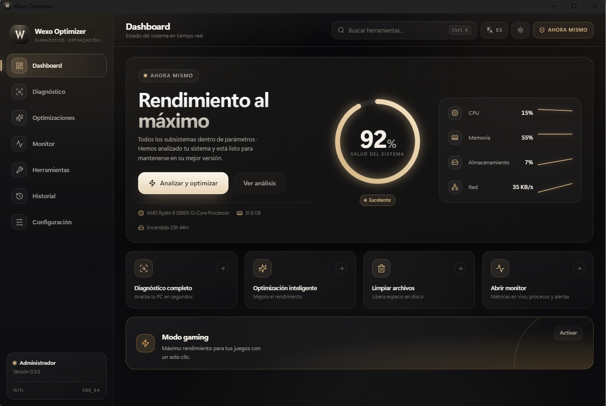
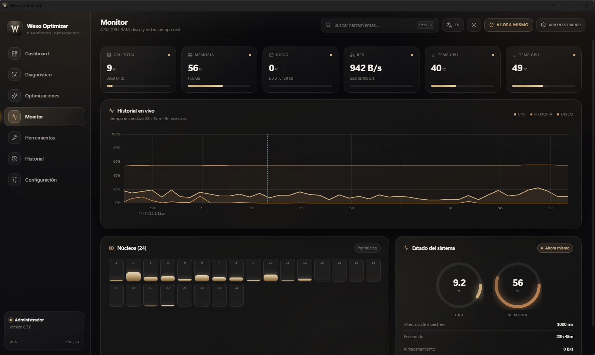

<div align="center">


# Wexo Optimizer

**Diagnose, optimize and monitor your PC. No empty promises.**

Atomic, verified and reversible changes on Windows 10/11 and Linux.
Real system metrics, never made-up values.

<br />

<a href="https://github.com/02kenzz/WexoOptimizer/releases/latest"></a>
<a href="https://github.com/02kenzz/WexoOptimizer/actions/workflows/ci.yml"></a>
<a href="LICENSE"></a>


<a href="https://github.com/02kenzz/WexoOptimizer/releases"></a>

<br />

[Install](#install) ·
[Screenshots](#screenshots) ·
[Features](#features) ·
[Build](#build-from-source) ·
[Architecture](#architecture) ·
[Changelog](CHANGELOG.md) ·
[Español](README.md)

</div>

---



<div align="center">
  <sub>Dashboard · system health, real hardware and quick actions in one view.</sub>
</div>

---

## What it is

A desktop control center to know **what is happening on your machine** and **change only what you understand**, with the option to undo it.

- **Real data**: CPU, GPU, memory, disks, network and temperatures read from the system. If a sensor does not exist, the UI shows `—` or “No sensor”; never a made-up number.
- **Safe changes**: every optimization captures a snapshot, applies atomically, verifies the result and records it in SQLite so it can be reverted with one click.
- **Low overhead**: the monitor uses circular buffers and configurable intervals, designed to stay light in the background.
- **Bilingual**: full Spanish and English UI, with light, dark, system and high-contrast themes.

> **Current status:** v0.3.0. Diagnostics, monitor, optimization engine, rollback, tools and overlay working on Windows. On Linux, monitoring and GNOME/systemd optimizations are operational.

---

## Screenshots

<table>
  <tr>
    <td width="50%" align="center" valign="top">
      <a href="docs/screenshots/dashboard.png"></a>
      <br />
      <sub><strong>Dashboard</strong><br />System health, detected hardware and prioritized recommendations.</sub>
    </td>
    <td width="50%" align="center" valign="top">
      <a href="docs/screenshots/monitor.png"></a>
      <br />
      <sub><strong>Monitor</strong><br />Total and per-core CPU, GPU, RAM, disk, network and live temperatures.</sub>
    </td>
  </tr>
</table>

---

## Features

### Diagnostics

- Hardware profile: CPU, RAM modules, channels and speed, GPU, disks with SMART status, OS and uptime.
- Global and per-subsystem health score with prioritized findings.
- Bottleneck detection backed by measurable evidence (CPU p50/p95, memory pressure, disk saturation, network) and a confidence level.
- Dynamic rules only fire when enough monitor samples exist: no data, no conclusions.

### Optimizations

- **Windows:** SysMain, DiagTrack telemetry, high-performance power plan, TCP autotuning, HAGS, visual effects and NTFS last access.
- **Linux:** GNOME animations, Bluetooth and `vm.swappiness`.
- Dry run before touching anything, with requirement, conflict and administrator checks.
- Atomic apply with snapshot, post-apply verification and automatic rollback if anything fails.
- Transaction history with hashes to return to the exact previous state.

### Monitor

- Total and per-core CPU, memory, disk, network, uptime and live historical charts.
- GPU temperature via NVML and CPU temperature with a fallback chain: ACPI zones → LibreHardwareMonitor → no sensor.
- Configurable sampling, circular buffers and a low-idle-impact design target.
- Thermal and load indicators with clear thresholds.

### Tools

- Preview-first cleanup: temp files, logs and caches; files in use are skipped and freed space is reported.
- System repair: SFC and DISM.
- Disk maintenance: defragmentation, SSD TRIM and CHKDSK.
- Live console for every job, with elapsed time, exit code and a stop button.
- Internal database maintenance: vacuum and reindex.

### Performance overlay

- Floating panel with FPS, CPU, GPU and RAM on top of the game.
- Click-through, always on top and out of the taskbar.
- FPS counted from ETW present events: nothing is injected into the game. Requires administrator rights and windowed or borderless mode.

### Safety and privacy

- Snapshot and transaction before every change; one-click rollback from history.
- Final-state verification and an auditable SQLite log.
- **No telemetry by default**: nothing is sent without consent.
- The app elevates itself on launch; if you decline UAC it still opens, but administrator-only actions stay disabled.

---

## Install

### Windows 10/11

1. Download the NSIS installer from **[Releases](https://github.com/02kenzz/WexoOptimizer/releases/latest)**.
2. Run `Wexo.Optimizer_x.y.z_x64-setup.exe` and follow the wizard.
3. Accept the UAC prompt to enable system optimizations.

> **SmartScreen warning:** the installer is unsigned (open source project without a certificate budget). If “Windows protected your PC” appears, click *More info → Run anyway*. [Why and signing plan](docs/CODE_SIGNING.md).

> **CPU temperature:** some desktop boards do not expose ACPI thermal zones. In that case the Monitor reads the package sensor from [LibreHardwareMonitor](https://github.com/LibreHardwareMonitor/LibreHardwareMonitor). When installed, the app starts it minimized and configures its local web server; it needs the same administrator rights. Without it, the tile shows `—` instead of a made-up value.

> **No elevation:** launch the app with `--no-elevate` to skip the UAC prompt deliberately.

### Linux

The app runs on GNOME with systemd. Changes that need root relaunch through `pkexec`; snapshots keep systemd unit states and every file they touch, including files created by the tweak, which rollback removes.

---

## Build from source

**Requirements:** Node.js 20+, stable Rust and the Tauri v2 dependencies.

### Windows

```powershell
# Requires MSVC and Visual Studio Build Tools (C++ Desktop)
git clone https://github.com/02kenzz/WexoOptimizer
cd WexoOptimizer
npm install
npm run tauri dev      # Desktop app with Rust backend
npm run tauri build    # NSIS + MSI installers
```

### Linux

```bash
sudo apt install libwebkit2gtk-4.1-dev build-essential curl wget file \
  libxdo-dev libssl-dev libayatana-appindicator3-dev librsvg2-dev
npm install
npm run tauri dev
```

### Frontend only

```bash
npm run dev            # Vite with mocked data, no backend
```

---

## Architecture

```text
crates/wexo-core        Pure domain types and contracts (no OS dependencies)
crates/wexo-sysinfo     Hardware/OS collectors (sysinfo; WMI/PDH, /sys, NVML, LHM)
crates/wexo-optimizer   Optimization registry + apply/verify/rollback engine
crates/wexo-safety      Preflight, registry/file/systemd snapshots, SQLite log
crates/wexo-rules       Rules engine → recommendations and bottlenecks
crates/wexo-monitor     Metrics sampling, circular buffers and detection
crates/wexo-tools       Cleanup, SFC/DISM/defrag/TRIM/CHKDSK jobs and SQLite
src-tauri               Tauri v2 shell, IPC commands, state, elevation and logs
src/                    React 18 + TypeScript + Vite + Tailwind CSS 4
```

**Stack:** Tauri v2 · Rust workspace · React 18 · TypeScript · Tailwind CSS 4 · Zustand · TanStack Query · `ts-rs` typed IPC · uPlot · i18next · Vitest · `cargo test`

---

## Code signing

Open source project without an EV certificate budget.

| Option | Status |
| --- | --- |
| **Unsigned (current)** | Works, shows the SmartScreen warning |
| **SignPath.io** | Free for FOSS — planned |
| **Self-signed** | Internal testing only |

[Details →](docs/CODE_SIGNING.md)

---

## Releases

| Channel | Link |
| --- | --- |
| **Stable** | [Latest release](https://github.com/02kenzz/WexoOptimizer/releases/latest) |
| **All versions** | [Releases](https://github.com/02kenzz/WexoOptimizer/releases) |
| **Changes** | [CHANGELOG.md](CHANGELOG.md) |

The release flow starts when a `v*` tag is pushed: GitHub Actions builds the app, generates the NSIS installer and creates the release with the binary attached.

---

## Links

- **Code signing** → [docs/CODE_SIGNING.md](docs/CODE_SIGNING.md)
- **Issues** → [GitHub Issues](https://github.com/02kenzz/WexoOptimizer/issues)
- **Discussions** → [GitHub Discussions](https://github.com/02kenzz/WexoOptimizer/discussions)

---

## License

MIT © 2026 [02kenzz](https://github.com/02kenzz)
