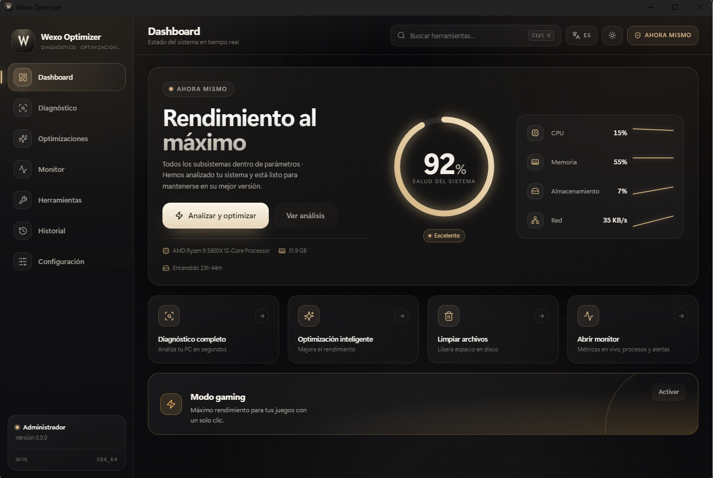
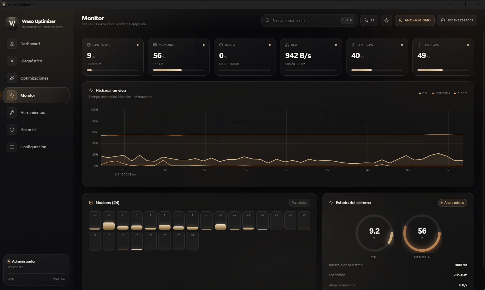

<div align="center">


# Wexo Optimizer

**Diagnostica, optimiza y monitoriza tu PC. Sin promesas vacías.**

Cambios atómicos, verificados y reversibles en Windows 10/11 y Linux.
Métricas reales del sistema, nunca valores inventados.

<br />

<a href="https://github.com/02kenzz/WexoOptimizer/releases/latest"></a>
<a href="https://github.com/02kenzz/WexoOptimizer/actions/workflows/ci.yml"></a>
<a href="LICENSE"></a>


<a href="https://github.com/02kenzz/WexoOptimizer/releases"></a>

<br />

[Instalación](#instalación) ·
[Capturas](#capturas) ·
[Características](#características) ·
[Compilar](#compilar-desde-el-código) ·
[Arquitectura](#arquitectura) ·
[Changelog](CHANGELOG.md) ·
[English](README.en.md)

</div>

---



<div align="center">
  <sub>Dashboard · salud del sistema, hardware real y acciones rápidas en una sola vista.</sub>
</div>

---

## Qué es Wexo Optimizer

Un centro de control de escritorio para saber **qué está pasando en tu equipo** y **cambiar solo lo que entiendes**, con la posibilidad de deshacerlo.

- **Datos reales**: CPU, GPU, memoria, discos, red y temperaturas leídos del sistema. Si un sensor no existe, la interfaz muestra `—` o «Sin sensor»; nunca un número inventado.
- **Cambios seguros**: cada optimización captura un snapshot, se aplica de forma atómica, se verifica y queda registrada en SQLite para revertirla con un clic.
- **Bajo consumo**: el monitor usa buffers circulares e intervalos configurables, con el objetivo de mantenerse ligero en segundo plano.
- **Bilingüe**: interfaz completa en español e inglés, con temas claro, oscuro, sistema y alto contraste.

> **Estado actual:** v0.3.0. Núcleo de diagnóstico, monitor, motor de optimizaciones, rollback, herramientas y overlay funcionando en Windows. En Linux están operativas la monitorización y las optimizaciones para GNOME/systemd.

---

## Capturas

<table>
  <tr>
    <td width="50%" align="center" valign="top">
      <a href="docs/screenshots/dashboard.png"></a>
      <br />
      <sub><strong>Dashboard</strong><br />Salud del sistema, hardware detectado y recomendaciones priorizadas.</sub>
    </td>
    <td width="50%" align="center" valign="top">
      <a href="docs/screenshots/monitor.png"></a>
      <br />
      <sub><strong>Monitor</strong><br />CPU total y por núcleo, GPU, RAM, disco, red y temperaturas en vivo.</sub>
    </td>
  </tr>
</table>

---

## Características

### Diagnóstico

- Perfil de hardware: CPU, módulos de RAM, canales y velocidad, GPU, discos con estado SMART, sistema operativo y uptime.
- Puntuación de salud global y por subsistema, con hallazgos priorizados.
- Detección de cuellos de botella con evidencia medible (CPU p50/p95, presión de memoria, saturación de disco, red) y nivel de confianza.
- Reglas dinámicas que solo se activan cuando hay muestras suficientes del monitor: sin datos, no hay conclusiones.

### Optimizaciones

- **Windows:** SysMain, telemetría DiagTrack, plan de energía de alto rendimiento, autotuning de TCP, HAGS, efectos visuales y último acceso NTFS.
- **Linux:** animaciones de GNOME, Bluetooth y `vm.swappiness`.
- Vista previa (*dry run*) antes de tocar nada, validación de requisitos, conflictos y permisos de administrador.
- Aplicación atómica con snapshot, verificación posterior y rollback automático si algo falla.
- Historial de transacciones con hash para volver al estado exacto anterior.

### Monitor

- CPU total y por núcleo, memoria, disco, red, uptime y gráficas históricas en vivo.
- Temperatura de GPU vía NVML y de CPU con cadena de respaldo: zonas ACPI → LibreHardwareMonitor → sin sensor.
- Muestreo configurable, buffers circulares y objetivo de diseño de bajo impacto en reposo.
- Indicadores térmicos y de carga con umbrales claros.

### Herramientas

- Limpieza con vista previa: temporales, logs y cachés; los archivos en uso se omiten y se informa de lo liberado.
- Reparación del sistema: SFC y DISM.
- Mantenimiento de disco: desfragmentación, TRIM para SSD y CHKDSK.
- Consola en vivo para cada tarea, con duración, código de salida y opción de detener.
- Mantenimiento de la base de datos interna: *vacuum* y reindexado.

### Overlay de rendimiento

- Panel flotante con FPS, CPU, GPU y RAM sobre el juego.
- *Click-through*, siempre visible y fuera de la barra de tareas.
- FPS contados desde eventos *present* de ETW: sin inyección en el juego. Requiere permisos de administrador y modo ventana o sin bordes.

### Seguridad y privacidad

- Snapshot y transacción antes de cada cambio; rollback en un clic desde el historial.
- Verificación del estado final y registro auditable en SQLite.
- **Sin telemetría por defecto**: no se envía nada sin consentimiento.
- La app se autoeleva al arrancar; si rechazas el aviso UAC, sigue abriéndose y las acciones que requieren administrador quedan desactivadas.

---

## Instalación

### Windows 10/11

1. Descarga el instalador NSIS desde **[Releases](https://github.com/02kenzz/WexoOptimizer/releases/latest)**.
2. Ejecuta `Wexo.Optimizer_x.y.z_x64-setup.exe` y sigue el asistente.
3. Acepta el aviso de UAC para habilitar las optimizaciones del sistema.

> **Aviso de SmartScreen:** el instalador no está firmado (proyecto open source sin presupuesto para certificado). Si aparece «Windows protegió tu PC», pulsa *Más información → Ejecutar de todas formas*. [Motivos y plan de firma](docs/CODE_SIGNING.md).

> **Temperatura de CPU:** algunas placas de escritorio no exponen zonas térmicas ACPI. En ese caso el Monitor lee el sensor del paquete desde [LibreHardwareMonitor](https://github.com/LibreHardwareMonitor/LibreHardwareMonitor). Si está instalado, la app lo inicia minimizado y configura su servidor web local; necesita los mismos permisos de administrador. Sin él, la tarjeta muestra `—` en lugar de un valor inventado.

> **Sin elevación:** inicia la app con `--no-elevate` para omitir el aviso de UAC a propósito.

### Linux

La app se ejecuta en GNOME con systemd. Para los cambios que requieren root se relanza mediante `pkexec`; los snapshots conservan el estado de las unidades de systemd y de cada archivo tocado, incluidos los creados por la optimización, que el rollback elimina.

---

## Compilar desde el código

**Requisitos:** Node.js 20+, Rust estable y las dependencias de Tauri v2.

### Windows

```powershell
# Requiere MSVC y Visual Studio Build Tools (C++ Desktop)
git clone https://github.com/02kenzz/WexoOptimizer
cd WexoOptimizer
npm install
npm run tauri dev      # App de escritorio con backend Rust
npm run tauri build    # Instaladores NSIS + MSI
```

### Linux

```bash
sudo apt install libwebkit2gtk-4.1-dev build-essential curl wget file \
  libxdo-dev libssl-dev libayatana-appindicator3-dev librsvg2-dev
npm install
npm run tauri dev
```

### Solo frontend

```bash
npm run dev            # Vite con datos simulados, sin backend
```

---

## Arquitectura

```text
crates/wexo-core        Tipos de dominio puros y contratos (sin dependencias de SO)
crates/wexo-sysinfo     Colectores de hardware/SO (sysinfo; WMI/PDH, /sys, NVML, LHM)
crates/wexo-optimizer   Registro de optimizaciones + motor apply/verify/rollback
crates/wexo-safety      Preflight, snapshots de registro/archivos/systemd, log SQLite
crates/wexo-rules       Motor de reglas → recomendaciones y cuellos de botella
crates/wexo-monitor     Muestreo de métricas, buffers circulares y detección
crates/wexo-tools       Limpieza, jobs SFC/DISM/defrag/TRIM/CHKDSK y SQLite
src-tauri               Shell Tauri v2, comandos IPC, estado, elevación y logs
src/                    React 18 + TypeScript + Vite + Tailwind CSS 4
```

**Stack:** Tauri v2 · Rust workspace · React 18 · TypeScript · Tailwind CSS 4 · Zustand · TanStack Query · `ts-rs` para IPC tipado · uPlot · i18next · Vitest · `cargo test`

---

## Firma de código

Proyecto open source, sin presupuesto para un certificado EV.

| Opción | Estado |
| --- | --- |
| **Sin firmar (actual)** | Funciona, muestra el aviso de SmartScreen |
| **SignPath.io** | Gratis para FOSS — planificado |
| **Autofirmado** | Solo para pruebas internas |

[Detalles →](docs/CODE_SIGNING.md)

---

## Releases

| Canal | Enlace |
| --- | --- |
| **Estable** | [Última versión](https://github.com/02kenzz/WexoOptimizer/releases/latest) |
| **Todas las versiones** | [Releases](https://github.com/02kenzz/WexoOptimizer/releases) |
| **Cambios** | [CHANGELOG.md](CHANGELOG.md) |

El flujo de publicación se dispara al subir un tag `v*`: GitHub Actions compila, genera el instalador NSIS y crea el release con el binario adjunto.

---

## Enlaces

- **Firma de código** → [docs/CODE_SIGNING.md](docs/CODE_SIGNING.md)
- **Issues** → [GitHub Issues](https://github.com/02kenzz/WexoOptimizer/issues)
- **Discusiones** → [GitHub Discussions](https://github.com/02kenzz/WexoOptimizer/discussions)

---

## Licencia

MIT © 2026 [02kenzz](https://github.com/02kenzz)
